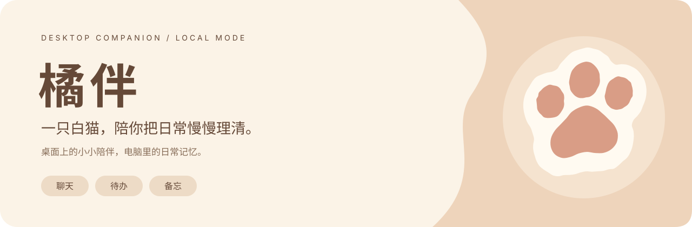
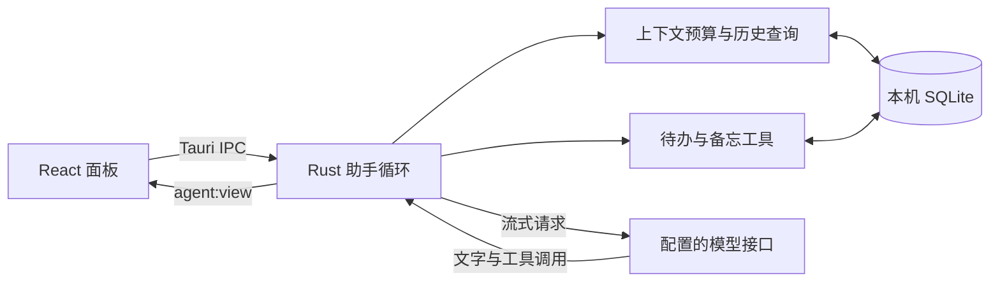

<div align="center">



**一只住在桌面上的白猫，陪你聊天，把想做的事记下来。**

<kbd>macOS</kbd> · <kbd>Tauri 2</kbd> · <kbd>Rust + SQLite</kbd> · <kbd>自选模型</kbd>

[开始使用](#开始使用) · [能做什么](#能做什么) · [数据与隐私](#数据与隐私) · [单机模式说明](docs/LOCAL_MODE.md)

</div>

---

橘伴是一款桌面 AI 伴侣。奶油白与浅杏橘的小面板按需展开，聊天、待办与备忘都在猫咪身边。

**单机模式由 Rust 在本机运行助手逻辑，SQLite 保存聊天和事项，直接连接你配置的模型接口。** 使用单机模式无需 Python、PostgreSQL 或 Redis。

“单机”指应用逻辑和数据保存在本机。选择远程模型时，本轮消息、选中的历史及工具结果仍会发送到该模型服务。

## 开始使用

当前提供源码运行与 macOS `.app` 构建流程；桌面交互已在 macOS 验证。

### 1. 准备开发环境

| 依赖 | 版本或要求 |
| --- | --- |
| Node.js | 24.12 或以上的 24.x 版本；本机验证使用 24.15 |
| pnpm | `11.6.0`，与 `package.json` 一致 |
| Rust / Cargo | stable 工具链；本机验证使用 Rust 1.95 |
| Xcode | 安装 Xcode 或 Command Line Tools，提供 macOS 构建工具 |
| 模型服务 | 支持 OpenAI 兼容 Chat Completions、流式输出及工具调用的接口 |

### 2. 启动橘伴

在仓库根目录运行：

```bash
pnpm install --frozen-lockfile
pnpm tauri dev
```

启动后，白猫出现在桌面。点猫脚边的 **聊一会** 打开面板，再点右上角 **连接设置**。

### 3. 配置单机模式

在设置中选择 **单机**，填写以下内容，点击 **保存并连接**。

| 设置项 | 填写内容 |
| --- | --- |
| 模型服务地址 | 模型提供方给出的兼容接口根地址，通常以 `/v1` 结尾 |
| API Key | 对应服务的密钥，保存到系统钥匙串 |
| 模型 | 该接口实际支持的模型标识，可手动填写或获取模型列表 |

远程地址使用 HTTPS；本机回环地址支持 HTTP。地址、密钥和模型填写完整后才启用发送。当前源码仍保留服务端模式入口，首次使用请明确选择 **单机**；本仓库不包含 Python 服务端和管理后台。

### 4. 开始对话

先发一句“你好，陪我开始今天的工作吧”。你会看到等待状态、逐步显示的回复和保存下来的聊天记录。

也可以直接打开 **待办** 或 **备忘录** 管理事项，列表操作不需要调用模型。详细设置和常见问题见 [单机模式说明](docs/LOCAL_MODE.md)。

## 能做什么

| 陪伴 | 实用能力 |
| --- | --- |
| 白猫常驻桌面，支持拖动、轻点反馈、眨眼与休息 | 流式聊天，支持 Markdown、表格和代码块 |
| 奶油杏橘面板，紧凑聊天与展开阅读随时切换 | 通过对话创建、查询、完成待办，设置一次性提醒 |
| 调整桌宠大小、置顶状态，隐藏后从菜单栏找回 | 保存备忘与长期目标，修改、归档并设置回顾时间 |
| 聊天面板按需打开，保留历史与未发送草稿 | 查询本机会话的历史原文，按来源核对旧对话 |

助手只在工具实际返回成功后确认保存。中断任务保留已执行的工具结果，重启后不会自动重做业务操作。

### 让上下文有分寸

普通请求以 **6,000 个估算输入 token** 为目标，包含系统说明和工具定义。每次优先保留当前消息、最近完整对话和未完成事项的执行记录；必要内容超过目标时保留原文，并记录超额指标。

较早的对话达到阈值后，后台会尝试生成带来源的摘要；新消息优先。原始记录始终保留，助手需要细节时可以查询原文。历史较短时不生成摘要；摘要失败也不影响正常聊天。详见 [上下文与历史](docs/LOCAL_MODE.md#上下文与历史)。

## 数据与隐私

单机数据位于 macOS 应用目录：

```text
~/Library/Application Support/ai.desktop.pet.juban/
├── agent-local.db              聊天、工具记录、待办、备忘和摘要缓存
├── agent-config.json           连接配置，不保存单机 API Key 明文
└── companion-preferences.json  桌宠大小与置顶偏好
```

- **密钥**：单机 API Key 使用系统凭据存储；macOS 为 Keychain。
- **模型请求**：使用你选择的接口。聊天与摘要都会调用该接口，调用费用由模型提供方计收。
- **历史**：上下文裁剪只影响本次模型输入，不删除聊天记录。
- **模式**：单机与服务端的数据相互独立，切换模式不会自动同步或迁移。

备份或迁移前先退出应用，再备份整个应用目录。数据库备份不包含钥匙串中的密钥；换设备后需要重新配置密钥。

## 本机架构



| 目录 | 职责 |
| --- | --- |
| [`src/`](src/) | React 界面、桌宠交互与消息展示 |
| [`src-tauri/src/local_agent/`](src-tauri/src/local_agent/) | Rust 任务执行、上下文、SQLite 与能力插件 |
| [`src-tauri/src/llm/`](src-tauri/src/llm/) | 兼容模型请求、流式解析与工具调用拼接 |
| [`plugins/`](plugins/) | 待办与备忘的工具声明 |
| [`public/pets/white-cat-companion/`](public/pets/white-cat-companion/) | 当前白猫素材与透明遮罩 |

## 构建与检查

构建 macOS 应用：

```bash
pnpm tauri build --bundles app
```

产物位于 `src-tauri/target/release/bundle/macos/橘伴.app`。

开发检查：

```bash
pnpm test
cargo test --manifest-path src-tauri/Cargo.toml --lib
pnpm build
```

`pnpm build` 检查 TypeScript 并构建前端；`pnpm tauri build` 进一步编译 Rust 和打包原生应用。单元测试与构建通过不代表模型服务已连接，真实对话仍需使用你的接口验证。

## 当前边界

- 当前桌面体验与打包流程以 **macOS** 为准；Windows、Linux 尚未完成同等验收。
- 单机模式不内置模型。完全离线使用需要自行配置兼容的本地模型服务。
- 提醒和回顾需要橘伴运行；退出期间不弹出，重新运行后检查未处理事项。当前支持一次性时间，不支持重复日程。
- 摘要与模型回答仍会出错。重要信息应核对原文；待办与备忘的当前状态以实际列表和工具结果为准。
- 历史查询提供有来源的有限摘录，尚未提供语义搜索、跨设备同步或自动用户画像。

更多行为与排查方法见 [单机模式说明](docs/LOCAL_MODE.md)。
