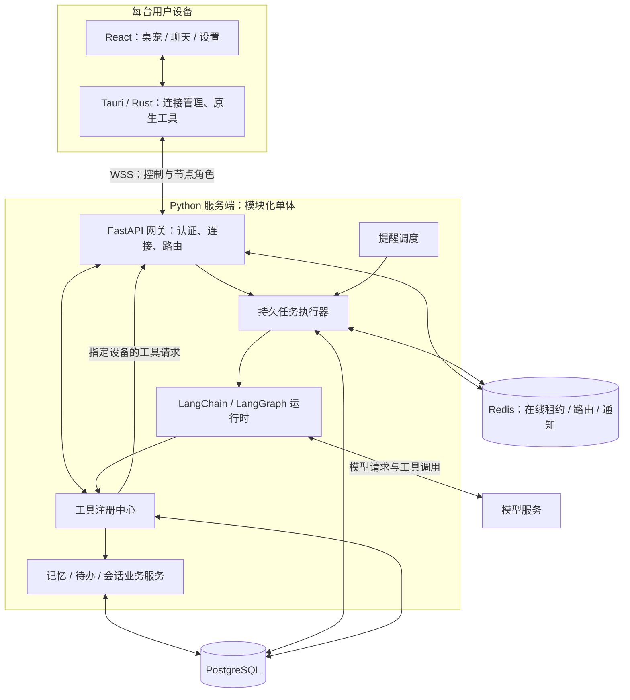

# 服务端智能体与桌面设备节点：已确认方向

> 2026-09-08：本文描述的是**服务端模式**的链路与决策。桌面端现为双模式架构（服务端 / 单机可切换，单机模式由 Rust 直调模型、SQLite 本地持久化、API Key 存 OS 凭据存储），双模式全景见 [ARCHITECTURE.md](ARCHITECTURE.md)。

更新日期：2026-09-07。状态：**架构方向已确认，三个子任务代码已落地；真实只读查询和服务重启检查已通过，创建与查询已由用户手动验收通过，完整桌面恢复仍待验收**。

本文记录本轮逐项确认的决定。最小实现方案见[任务 PRD](../.trellis/tasks/09-07-server-agent-todo-mvp/prd.md)、[技术设计](../.trellis/tasks/09-07-server-agent-todo-mvp/design.md)和[实施计划](../.trellis/tasks/09-07-server-agent-todo-mvp/implement.md)。

## 工作约束

- 先记录架构方向，再规划和实现最小闭环；后续一次讨论一个关键决策。
- 当前优先确认技术与架构。习惯如何学习、何时主动提醒等业务细则暂不展开。
- 智能体核心集中部署在服务端；设备客户端无需安装或内置 Python 智能体运行环境。
- 现有桌宠角色、气泡框、窗口行为应保留；与其他正在进行的界面任务协调变更。
- 所有验证注明证据等级。空数据库展示真实空状态，不以模拟回复或演示数据替代真实链路。

## 当前实现与验证范围

服务端模式的链路为 `src/App.tsx → src/lib/agent.ts → src-tauri/src/backend/server.rs → server/app/main.py → server/app/agent_service.py`。Rust 连接独立 Python 服务，LangGraph 调用模型及待办工具，PostgreSQL 保存会话、任务、工具结果和待办，Redis 保存节点租约。

本机真实模型的待办查询、流式事件、重复请求幂等与协议重连已通过；桌面已显示发送记录、真实空结果和已完成工具。服务重启后同一会话快照保持一致。用户已手动确认创建待办并查询到记录；界面逐段流式和断线期间状态没有完整捕获。详见[验收记录](../.trellis/tasks/09-07-server-agent-todo-mvp/verification.md)。

[双模式全景](ARCHITECTURE.md)记录桌面端当前运行状态；服务端接入以本文及[服务端说明](../server/README.md)为准。

## 已确认的决策

| 编号 | 决策 | 职责与边界 |
| --- | --- | --- |
| D01 | 保留 Tauri / Rust 与 React / TypeScript | 客户端交互、原生能力、本机操作执行；不承担集中智能体编排 |
| D02 | Python 智能体核心 | 部署在服务端，服务多个设备；大模型通过服务端适配器调用 |
| D03 | LangChain + LangGraph | 模型及工具接入、执行编排、配合持久化实现状态保存 |
| D04 | WebSocket / WSS | 设备主动连接网关；正式远程连接加密；区分聊天控制和设备执行角色 |
| D05 | FastAPI | HTTP 与 WebSocket 接入、认证及应用接口 |
| D06 | PostgreSQL | 用户、设备绑定、工具定义、会话、记忆、待办、提醒计划、任务及执行结果 |
| D07 | 模块化单体 | 同一后端项目，分通信网关、智能体运行时、业务服务、提醒调度四个模块 |
| D08 | 工具注册中心 + 执行路由 | 工具定义与执行实例分开；注册中心内置于服务端 |
| D09 | 用户账号 + 设备绑定 + 独立设备凭证 | 按账号隔离数据，按设备授权执行，可单独撤销设备 |
| D10 | Redis 实时协调 | 在线租约、路由元数据、热点缓存与进程间通知；真实连接由网关进程持有 |
| D11 | 单主智能体 + 多工具 | 每次任务独立上下文和状态；单角色不等于全服务串行 |
| D12 | 持久任务 + 后台执行器 | 任务先写 PostgreSQL，执行不依赖 WebSocket 存活；结果不明的副作用不盲目重试 |
| D13 | 能力插件 seam | 可声明内容（工具 schema、名映射、提示词片段、错误文案）收敛为共享 `plugin.json`；双端循环只依赖插件注册表接口，待办是首个范例插件 |

Python/Rig 语言对比已收敛：本项目选择服务端 Python 的 LangChain/LangGraph 体系。
此前讨论的“每台设备运行 Python Sidecar”和“Rust/Rig 作为智能体核心”不属于后续默认实现方向。

## 目标模块关系

图中的提醒调度和设备自动化是目标边界；本次 MVP 的实际交付清单以 PRD 为准。

## 能力插件：如何新增一个插件

核心 agent 循环不硬编码任何工具域；新能力 = 新增一个插件包，而不是在双端循环里散落修改。可声明化的内容集中在共享描述文件 `plugins/<名称>/plugin.json`（仓库根，双端单一事实源；Rust 端 `include_str!` 编译期嵌入，Python 端运行时加载同文件）：

- `tools`：工具定义数组（name/version/description/input_schema/permission/execution_location/handler_key；`handler_key` 即模型侧下划线名，`name_mapping` 声明模型名 ↔ 业务名）。
- `prompt_fragments`：有序片段数组（`[{key, text}]`）；声明顺序即核心固定布局（核心头 → 片段槽 → 核心中段 → 片段槽 → 核心尾）的填槽顺序，槽位数不符启动即拒绝。
- `validation_messages`：参数校验错误文案表（双端校验器共用文案）。
- `affects`：该插件确认的副作用触发哪些前端刷新组（如 `todo-list`）。
- `rest_endpoints`：声明性端点清单；路由仍由核心挂载，不做动态注册。

各端落地清单（以 todo 为范例）：

1. **服务端**：建 `server/app/plugins/<名称>/` 包——`manifest.py`（加载共享 plugin.json）、`store.py`（领域存储方法；事务/事件骨架留 `runtime_store.py`）、`tools.py`（`<名称>Plugin`：`definitions` / `model_tools` / `prompt_fragments` / `validate` / `execute_in_tx`）。把实例加入 `app/plugin_runtime.py` 的 `builtin_plugins()`（显式有序清单，非文件系统扫描）。执行骨架（幂等 start_tool → 注册中心校验 → 事务内业务 + 结果同提交 → 错误消毒）在 `PluginRegistry`，插件不重复实现。
2. **Rust 单机模式**：建 `src-tauri/src/local_agent/plugins/<名称>/`（`manifest.rs` / `store.rs` / `mod.rs` 对称结构），实现 `ToolPlugin` trait 并注册进 `plugin_runtime.rs` 的 `builtin_plugins()`；直连命令在 `backend/mod.rs` 挂载点经 `<名称>Store::new(&store)` 调用。
3. **前端**：建 `src/lib/<名称>/presentation.ts`（返回 `{ name, status, text }` 的展示函数 + `affects` 声明，工具名/刷新组可直接 import 共享 plugin.json 派生），在 `src/lib/tool-plugins.ts` 的显式清单注册一行。ChatPanel 只查通用展示表；未注册的工具降级为通用展示而不报错。
4. **测试**：双端等价性（从同一 plugin.json 产出的模型工具 schema 相等）、提示词全文快照 + 填槽顺序/计数拒绝、执行骨架行为矩阵（幂等重放、参数错误、冲突消毒）、前端注册表降级与 affects 派发。新增插件的加载能力由双端 dummy 插件测试（仅声明 + 空 handler，核心零改动）背书。

设备端能力仍未开放：`capabilities` 必须为空数组的校验保持不变。

## 工具注册与执行

工具定义包含稳定名称、用途、参数结构、版本与权限要求。执行实例记录服务端处理器或设备 ID、能力版本及在线租约。

- 服务端工具：待办记录、记忆读写、网络信息检索等。
- 设备端工具：设备文件、截图、应用操作等，由目标设备实现后登记。
- 注册声明必须匹配服务端允许的能力；设备自报能力不产生授权。
- 路由从已认证账号确定权限，不能信任模型或客户端提供的任意账号 ID。
- 调用设备工具必须定位到具体设备；离线或不支持时返回明确错误，不偷偷换机器执行。
- 客户端承担控制角色和节点角色，两者拥有不同权限。物理连接与协议细节在实现合同中明确。

## 存储与实时状态

PostgreSQL 是持久业务数据和任务结果的权威来源。LangGraph 检查点与业务表分开管理；检查点保存并不自动保证工具副作用只执行一次。

Redis 保存可以通过认证重连或数据库重新建立的在线状态、路由信息和通知。在线条目必须有过期时间；失去有效租约后停止设备路由。持久设备注册记录不等同于设备当前在线。

Redis Pub/Sub 只用于唤醒或状态通知；断线会丢消息，任务执行器仍需查询 PostgreSQL 中未处理的记录。任务记录不能只存在于 Redis 通知中。

## 跨设备与恢复

- 同一账号共享服务端数据，设备只缓存界面所需快照与本地设置。
- 任务、工具调用、连接和消息各有独立标识；连接重建不应被当成新任务。
- 设备端执行完成但结果丢失时，记录“待核实”，先核对执行记录，不盲目重放有副作用的操作。
- 服务器仍运行时，设备离线不影响服务端任务记录；需要本机能力的步骤须等待或按策略失败。具体离线等待时长后续确认。
- 截图、点击和文件访问属于需要实现并验证的设备工具能力，不因接入 LangChain 或注册中心而自动获得。
- 服务端可以在开发电脑上手动运行以联调，部署边界仍然是独立服务；Tauri 不启动它。

## 后续方向

1. 最小闭环：远程聊天创建、查询待办，验证真实模型、数据库和客户端链路。
2. 设备执行闭环：选择一项真实本机能力，验证登记、授权、路由、结果回传和断线边界。
3. 偏好与记忆：明确记录来源、修改与撤销规则，再选择检索方式。
4. 主动提醒：确认习惯规则后实现调度、免打扰、投递及反馈。
5. 生产与扩展：多进程/多实例协调、部署与备份、跨平台打包、监控和容量验证。

这些是后续方向，不是本次已承诺实现的完整功能列表。

## 官方依据与证据边界

以下资料在本轮讨论中核对，用于支持技术能力，不等于本项目已经完成集成：

- [OpenClaw 设备节点](https://docs.openclaw.ai/nodes)：Gateway 处理模型与路由，Node 执行本机操作。借鉴角色划分，不声称使用相同技术栈或兼容其协议。
- [LangGraph 概览](https://docs.langchain.com/oss/python/langgraph/overview)：有状态编排与持久执行能力。
- [LangGraph 持久化](https://docs.langchain.com/oss/python/langgraph/persistence)：检查点及 PostgreSQL 集成。
- [FastAPI WebSocket](https://fastapi.tiangolo.com/advanced/websockets/)：连接和消息收发基础。
- [Redis Pub/Sub](https://redis.io/docs/latest/develop/pubsub/#delivery-semantics)：至多一次投递，不能作为唯一可靠任务记录。
